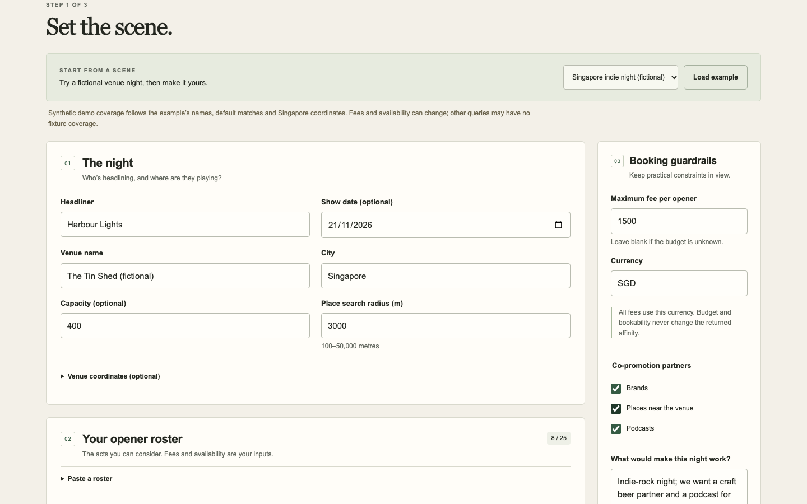
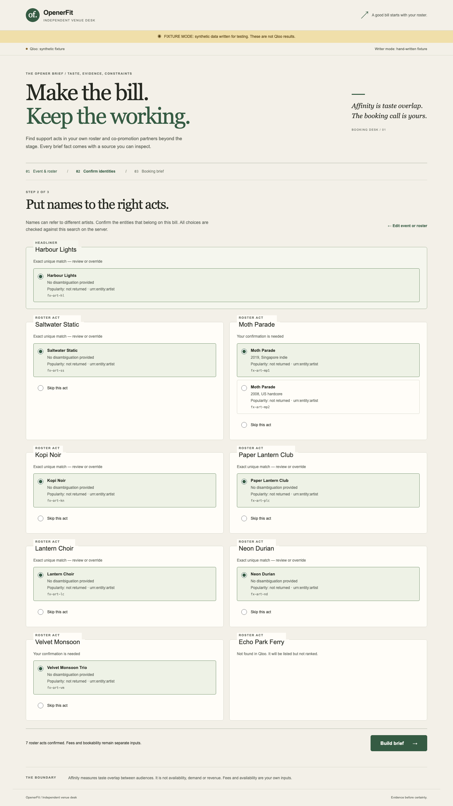
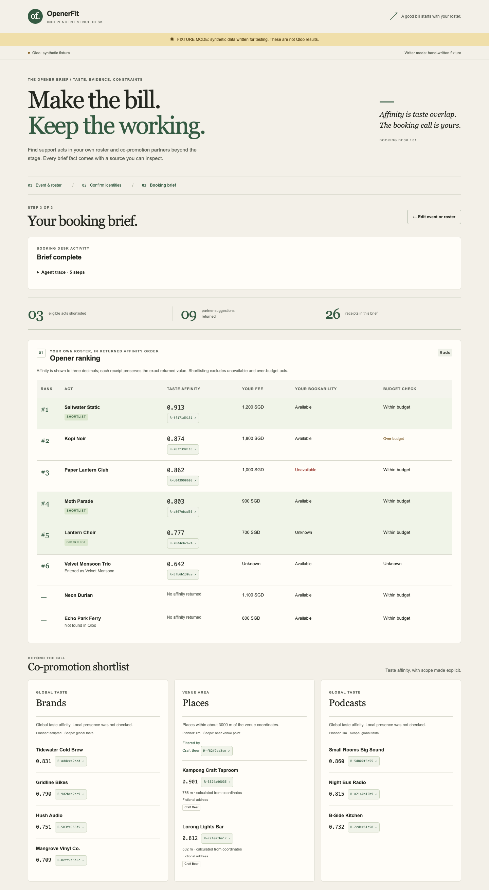
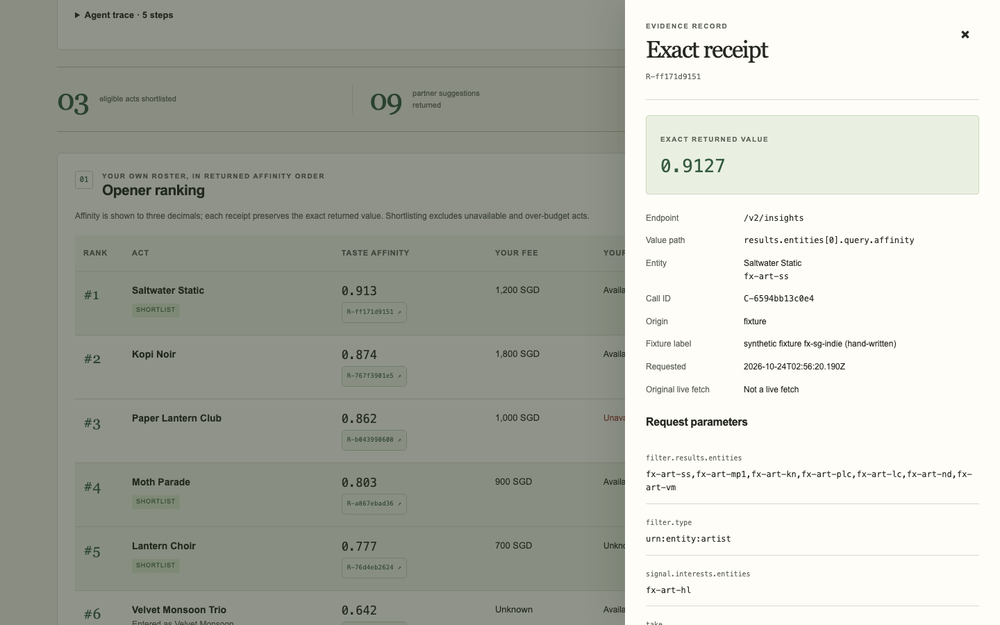

# OpenerFit

OpenerFit helps a venue booker rank their own artist roster by Qloo taste affinity to a headliner, confirm artist identities, explore taste-matched brand, place and podcast partners, and export a receipt-backed booking brief. Affinity is not demand, revenue, availability or a booking guarantee. Fees and bookability are supplied by the booker.

## Why Qloo is essential

Qloo supplies the taste-affinity ranking and partner insights. Without Qloo, the agent can only guess taste relationships. An optional same-model LLM-only baseline makes that difference inspectable; it is illustrative, not a benchmark or evidence of measured improvement.

## How the agent works

The planner loop proposes schema-checked tool actions within call and turn budgets. Tag signals must use observed IDs. Deterministic domain code builds a catalogue of supported claims; the model selects claim IDs instead of inventing booking claims. Labelled scripted-planner and template-writer fallbacks keep failures visible. Receipts link claims to query, response and parsing evidence.

## Modes and examples

- `QLOO_MODE=fixture|live`: synthetic fixture responses or the Qloo API. A key alone never enables live mode.
- `LLM_MODE=none|fixture|openai-compatible`: scripted/template operation, synthetic model responses, or a configured model service.

The UI labels Qloo response provenance (fixture, live or cached) and planner/writer provenance and fallbacks separately. Fixture mode is not live Qloo or real inference. The fixture example uses synthetic artists and responses. The live example uses real artist names with a fictional venue and fictional fees; these are example booking inputs, not verified availability.

## Screenshots

These screenshots come from the synthetic fixture demo: fictional artists and hand-written responses, not Qloo data.


*Booking inputs for the synthetic fixture demo, using fictional artists and hand-written responses, not Qloo data.*


*Confirming fictional artist identities in the synthetic fixture demo; hand-written responses, not Qloo data.*


*Ranking and partner shortlists from the synthetic fixture demo: fictional artists and hand-written responses, not Qloo data.*


*Inspecting a receipt from the synthetic fixture demo: fictional artists and hand-written responses, not Qloo data.*

## Quick start

Use Node 24+ and pnpm 12.11.2. Install the full dependency set: the production start command uses `tsx`, a development dependency.

```sh
pnpm install --frozen-lockfile
pnpm dev:fixture
```

Open the URL printed by Vite, load the fixture example, resolve and confirm identities, then generate and export a brief. Production and checks:

```sh
pnpm build
pnpm start
pnpm typecheck
pnpm test
# Install Chromium if not already available:
pnpm exec playwright install chromium
# E2E serves the built files; always build first:
pnpm build
pnpm test:e2e
```

Playwright runs one Chromium worker on loopback port 5189. `pnpm check:env` prints presence only; `pnpm params:extract` regenerates the parameter schema from project-maintained factual definitions. `scripts/live-batch-core.ts` and `scripts/live-common.ts` are retained regression-test support, not supported public live-verification CLI commands.

## Environment

Set secrets on the server only. The table lists configuration names and purpose, never credentials.

| Names | Purpose / default |
|---|---|
| `QLOO_MODE`, `QLOO_API_KEY`, `QLOO_BASE_URL` | Fixture by default; live needs a private key and the hackathon API host |
| `QLOO_CACHE`, `QLOO_CACHE_DIR`, `QLOO_CACHE_TTL_HOURS` | Private server cache; on, `.cache/qloo`, 168 hours |
| `LLM_MODE`, `LLM_BASE_URL`, `LLM_MODEL`, `LLM_API_KEY` | None by default; configure provider for real inference |
| `LLM_TIMEOUT_MS`, `LLM_LLAMACPP` | 180000 ms; optional adapter compatibility switch off |
| `LLM_SUPPORTS_SEED` | Seed on by default; disable for providers without support |
| `LLM_REASONING_EFFORT` | Omitted by default; provider-specific |
| `LLM_PLANNER_MAX_TOKENS`, `LLM_WRITER_MAX_TOKENS`, `LLM_BASELINE_MAX_TOKENS` | Default output caps: 300 / 1200 / 900 |
| `HOST`, `PORT`, `TRUST_PROXY`, `NODE_ENV` | Bind address, port, trusted proxy setting and production static serving |

Recommended free LLM configurations below are a **documentary recommendation; verify with your own key**. Availability, quotas and schema acceptance depend on the provider and account. Switch configurations manually; there is no automatic provider failover.

| Setting | Primary: Groq | Fallback: Gemini |
|---|---|---|
| `LLM_MODE` | `openai-compatible` | `openai-compatible` |
| `LLM_BASE_URL` | `https://api.groq.com/openai/v1` | `https://generativelanguage.googleapis.com/v1beta/openai` |
| `LLM_MODEL` | `qwen/qwen3.8-27b` | `gemini-3.8-flash` |
| `LLM_SUPPORTS_SEED` | `1` | `0` |
| `LLM_REASONING_EFFORT` | `none` | `minimal` |
| `LLM_PLANNER_MAX_TOKENS` | `1024` | `4096` |
| `LLM_WRITER_MAX_TOKENS` | `2048` | `4096` |
| `LLM_BASELINE_MAX_TOKENS` | `4096` | `4096` |

For either configuration, supply `LLM_API_KEY` privately, use `LLM_TIMEOUT_MS=180000` and `LLM_LLAMACPP=0`. See provider [structured-output documentation](https://console.groq.com/docs/structured-outputs) and [Gemini compatibility documentation](https://ai.google.dev/gemini-api/docs/openai).

## Deployment

Follow [Render deployment](docs/deploy-render.md) for the included Dockerfile and Blueprint. Free hosting may sleep and shared API quotas can limit requests; no uptime or capacity guarantee is claimed.

## Data and privacy

No accounts, analytics or cookies are implemented. Typed form data is stored locally in the browser; runs and private server caches have separate lifetimes. Qloo and any configured model provider receive relevant inputs. Do not enter confidential information in a public demo. Read [PRIVACY.md](PRIVACY.md) for storage and provider data-use details. Never publish live Qloo response data.

## Limitations and verification

<!-- LIVE-STATUS --> Live Qloo path: pending live verification.

<!-- LIVE-STATUS --> Real-model path: pending live verification.

Fixture tests do not establish live API compatibility, provider acceptance, recommendation quality or measured improvement. Taste affinity does not verify artist availability, fees, audience conversion or partner willingness. Identity confirmation and receipt review remain the booker's responsibility.

## Project history and provenance

OpenerFit was created on 18 October 2026 for the Qloo Agentic Hackathon, inside the 30 September–30 October 2026 submission period. This public repository is a curated single-commit snapshot of a private development repository whose history runs from 18 to 24 October 2026 (135 commits at the time of the snapshot).

Private source commit: `1951fc2153a87571ef4c866dd521e378dc5b5477` (branch tip the snapshot was taken from; this provenance note was added on top of it). <!-- SOURCE-COMMIT -->

Internal process notes and copied third-party documentation were omitted. All third-party license notices are retained in [THIRD_PARTY_NOTICES.md](THIRD_PARTY_NOTICES.md).

<!-- AI-ASSISTANCE-STATEMENT -->

## License

MIT; see [LICENSE](LICENSE) and [third-party notices](THIRD_PARTY_NOTICES.md). Upstream [Qloo documentation](https://docs.qloo.com/) is linked, not redistributed. Model services have separate terms.
